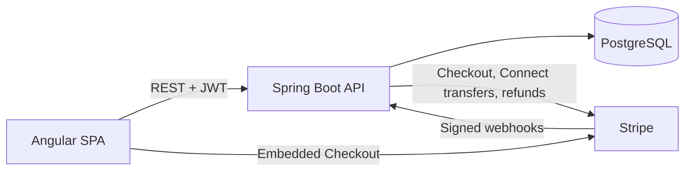

<div align="center">

# Sequan

**Multi-party escrow platform: create, fund, release and refund with enforced rules and a full audit trail.**

[](https://github.com/achrefbenkacem96/sequan/actions/workflows/ci.yml)


</div>

---

## Overview

Clients create an escrow, invite participants, fund it through Stripe, and release or refund the money under business rules enforced by the server. Every state change is recorded.

> [!NOTE]
> Stripe does not provide legal escrow accounts. Sequan implements escrow-*like* fund holding using platform balances, Connect transfers and refunds.

## Highlights

- **Enforced state machine:** controllers never accept a raw `status`; only valid transitions are possible.
- **Webhook-driven truth:** a payment counts only when a signature-verified Stripe webhook confirms it.
- **Safe money handling:** integer minor units, optimistic locking and idempotency keys on fund, release and refund.
- **Auditable:** append-only ledger entries plus a per-escrow event history.
- **Minimal PCI scope:** card data stays with Stripe Checkout and never touches Sequan.

## Architecture



| Layer | Stack |
|---|---|
| Frontend | Angular 19, Angular Material, RxJS, Stripe.js |
| Backend | Java 21, Spring Boot 3.4, Spring Security + JWT, JPA, Flyway |
| Database | PostgreSQL 16 |
| Payments | Stripe Checkout Sessions, Connect Transfers, Webhooks |

See [docs/architecture.md](docs/architecture.md) for the state machine, money model and webhook design.

## Getting started

### Prerequisites

- Java 21+ and Maven 3.9+
- Node.js 20+
- Docker
- A Stripe account and the [Stripe CLI](https://stripe.com/docs/stripe-cli)

### 1. Configure

```bash
cp .env.example .env
chmod 600 .env
openssl rand -base64 48   # paste the output into JWT_SECRET
```

Add your Stripe **test** keys to `.env`. See [Environment variables](#environment-variables).

### 2. Start the database

```bash
docker compose up -d postgres
```

### 3. Start the backend

```bash
cd backend
set -a; . ../.env; set +a
mvn spring-boot:run
```

### 4. Start the frontend

```bash
cd frontend
npm install
npm start
```

### 5. Forward Stripe webhooks

```bash
stripe listen --forward-to localhost:8080/api/webhooks/stripe
```

Copy the printed signing secret into `STRIPE_WEBHOOK_SECRET`, then restart the backend.

| Service | URL |
|---|---|
| App | http://localhost:4200 |
| API | http://localhost:8080 |
| Swagger UI | http://localhost:8080/api/swagger-ui.html |
| Health | http://localhost:8080/actuator/health |

To run PostgreSQL and the backend together in containers, use `docker compose up --build`, then run the Angular app locally.

## Environment variables

| Variable | Required | Purpose |
|---|---|---|
| `SPRING_DATASOURCE_URL` / `_USERNAME` / `_PASSWORD` | Local defaults | PostgreSQL connection |
| `JWT_SECRET` | **Yes** | HS256 signing secret, at least 32 bytes |
| `JWT_ACCESS_EXPIRATION_MS` | No | Access token lifetime |
| `JWT_REFRESH_EXPIRATION_MS` | No | Refresh token lifetime |
| `STRIPE_SECRET_KEY` | **Yes** | Stripe secret or restricted key |
| `STRIPE_PUBLISHABLE_KEY` | **Yes** | Publishable key served to the frontend |
| `STRIPE_WEBHOOK_SECRET` | **Yes** | Webhook signature secret |
| `APP_BASE_URL` | No | Frontend origin, used for Connect return URLs |
| `APP_API_BASE_URL` | No | Public API origin |
| `CORS_ALLOWED_ORIGINS` | No | Comma-separated allowed origins |

## Secrets and API keys

- **No secrets in the repository.** `.env` is gitignored and `.env.example` holds empty values only.
- **No fallback secrets.** Required values have no defaults, so a misconfigured deployment fails at startup instead of running with a known key.
- **Automated scanning.** CI runs [Gitleaks](https://github.com/gitleaks/gitleaks) across the full git history on every push and pull request.
- **Server-side only.** The Stripe secret key and webhook secret never reach the browser; the frontend receives only the publishable key.
- **Separate keys per environment.** Use test keys locally, and restricted (`rk_`) live keys held in a secret manager in production.

If a secret is ever exposed, rotate it in the provider dashboard first, then clean up the history. Deleting it from a later commit does not revoke it.

## API

| Area | Endpoints |
|---|---|
| Auth | `POST /api/auth/register`, `login`, `refresh`, `logout`; `GET /api/auth/me` |
| Dashboard | `GET /api/dashboard` |
| Escrows | `GET`, `POST /api/escrows` |
| Escrow actions | `POST /api/escrows/{id}/publish`, `cancel`, `accept`, `fund`, `releases`, `refunds`, `dispute` |
| History | `GET /api/escrows/{id}/events` |
| Connect | `POST /api/connect/onboarding-link` |
| Webhooks | `POST /api/webhooks/stripe` |

Full interactive documentation is available in Swagger UI.

## Escrow lifecycle

```mermaid
stateDiagram-v2
    direction LR
    [*] --> DRAFT
    DRAFT --> PENDING_PARTICIPANTS: publish
    PENDING_PARTICIPANTS --> PENDING_FUNDING: all accept
    PENDING_FUNDING --> FUNDED: webhook confirms payment
    FUNDED --> IN_PROGRESS
    IN_PROGRESS --> AWAITING_RELEASE: release requested
    AWAITING_RELEASE --> RELEASED: approved
    RELEASED --> [*]
```



Alternate paths cover cancellation or expiry before funding, partial release, refund and dispute resolution.

## Testing

```bash
# Backend
cd backend && mvn test

# Frontend
cd frontend && npm test -- --watch=false --browsers=ChromeHeadless
```

Critical coverage includes state transitions, money invariants, the JWT round trip and webhook signature rejection.

## Project structure

```text
.
├── backend/              Spring Boot API
│   └── src/main/resources/db/migration/   Flyway migrations
├── frontend/             Angular SPA
├── docs/                 Architecture notes
├── .github/workflows/    CI and secret scanning
├── docker-compose.yml
└── .env.example
```

Schema changes go through Flyway; Hibernate `ddl-auto` is `validate` only.

## Production checklist

- [ ] Store secrets in a secret manager and rotate JWT and Stripe keys regularly
- [ ] Use restricted Stripe keys
- [ ] Put Actuator behind authentication or a network policy
- [ ] Configure the Stripe webhook endpoint with signature verification
- [ ] Require Connect onboarding before releases
- [ ] Monitor failed `webhook_events` and retry them safely

## License

Proprietary. All rights reserved unless otherwise stated.
